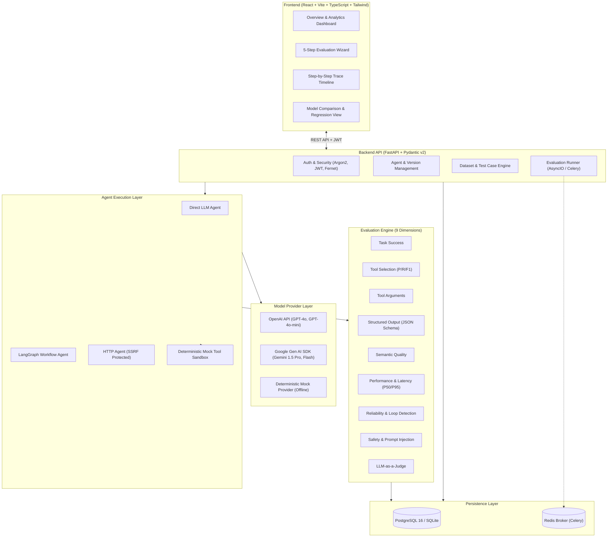

# AgentBench – LLM Agent Evaluation, Benchmarking & Observability Platform

[](https://www.python.org/)
[](https://fastapi.tiangolo.com)
[](https://vitejs.dev/)
[](https://tailwindcss.com/)
[](LICENSE)
[]()

> **AgentBench** is an enterprise-grade AI engineering platform designed to evaluate, benchmark, observe, and improve LLM-powered autonomous agents. It provides multi-agent execution, deterministic sandbox tools, a 9-dimensional evaluation engine, side-by-side model benchmarking, regression analysis, and step-by-step execution traces with secret redaction.

---

## Architecture Diagram



---

## Key Features

1. **Multi-Model Provider Independence**:
   - Native integration with **OpenAI** (`gpt-4o`, `gpt-4o-mini`).
   - Native integration with **Google Gemini** using the official `google-genai` SDK (`gemini-1.5-pro`, `gemini-1.5-flash`).
   - Deterministic **Mock Provider** for offline benchmarking, zero-cost CI/CD testing, and reproducible evaluations.
2. **Pluggable Agent Execution Engines**:
   - **Direct LLM Agent**: Native tool calling, cyclic conversation resolution, and system prompt steering.
   - **LangGraph Agent**: Graph state management, agent-to-tool routing nodes, and state persistence.
   - **External HTTP Agent**: Execute remote agent endpoints with built-in SSRF protection against private IP ranges.
3. **9-Dimensional Custom Evaluation Engine**:
   - **Task Success**: Validates keyword fulfillment and goal resolution without exceptions.
   - **Tool Selection**: Computes multiset Precision, Recall, and $F_1$ score for tool routing.
   - **Tool Argument Match**: Schema-aware normalized parameter matching (scalar, case-insensitive, nested dicts).
   - **Structured JSON Schema**: Strict `Draft7Validator` validation against arbitrary user JSON Schemas.
   - **Semantic Quality**: Cosine similarity against ground truth with fuzzy Levenshtein fallback.
   - **Performance Evaluator**: $P_{50}$, $P_{95}$ latency distributions, throughput (tokens/sec), and SLA compliance.
   - **Reliability Evaluator**: Infinite loop detection, circular call prevention, and unhandled exception penalties.
   - **Safety Evaluator**: System prompt leak checks, injection attack defense, and unauthorized tool gating.
   - **LLM-as-a-Judge**: Multi-criteria prompt-based scoring rubric (Relevance, Factuality, Helpfulness, Tone).
4. **Side-by-Side Model Benchmarking**:
   - Compare two evaluation runs under identical dataset conditions.
   - Differential metrics ($\Delta$ scores, latency deltas, token cost savings).
5. **Automated Regression Testing**:
   - Compare Candidate builds against Baseline standards.
   - Classify regressions into Minor, Major, and Critical severity.
   - Export regression reports to block faulty deployments.
6. **Detailed Execution Tracing & Observability**:
   - Interactive waterfall timeline for each test case.
   - Detailed inspection of System Prompts, Agent Steps, Tool Calls, Tool Outputs, and Final Answers.
   - **Automatic Secret Redaction**: Replaces OpenAI keys (`sk-...`), Gemini keys (`AIza...`), Bearer tokens, and passwords with `[REDACTED]`.
7. **Cost Economics**:
   - Live token usage calculation and dollar cost projection using real model pricing tables.

---

## Technology Stack

| Layer | Technologies |
|---|---|
| **Frontend** | React 18, Vite, TypeScript, Tailwind CSS, Lucide React, Recharts, React Router v6, TanStack Query, Axios, React Hook Form, Zod |
| **Backend** | Python 3.11+, FastAPI, Pydantic v2, SQLAlchemy 2.0, Alembic, PostgreSQL, SQLite (local zero-config) |
| **Security** | Argon2 password hashing, JWT authentication (HS256), Fernet symmetric encryption for stored API keys, SSRF validation |
| **Agent / AI** | Official `google-genai` SDK, `openai` async client, LangGraph, LangChain Core |
| **Background Tasks** | AsyncIO Concurrency Manager, Celery, Redis |
| **DevOps** | Docker, Docker Compose, Multi-stage Dockerfiles |

---

## Quick Start Guide

### Option A: Local Zero-Config Setup (Recommended for Quick Review)

AgentBench comes pre-configured with a zero-setup SQLite database and deterministic mock providers so you can run the entire system locally without Docker or external API keys.

#### 1. Backend Setup

```bash
# Navigate to backend directory
cd backend

# Create and activate virtual environment
python -m venv venv
# On Windows:
.\venv\Scripts\activate
# On Linux/macOS:
# source venv/bin/activate

# Install dependencies
pip install -r requirements.txt

# Run migrations and seed pre-configured demo data
python app/init_db.py

# Start the FastAPI server (runs on http://localhost:8000)
uvicorn app.main:app --host 0.0.0.0 --port 8000 --reload
```

#### 2. Frontend Setup

```bash
# Open a new terminal and navigate to frontend directory
cd frontend

# Install dependencies
npm install

# Start Vite development server (runs on http://localhost:5173)
npm run dev
```

Open your browser at **`http://localhost:5173`**.

---

### Option B: Docker Compose Setup (Production-grade)

For a complete containerized deployment with PostgreSQL and Redis:

```bash
# From the repository root
docker-compose up --build
```

- **Frontend**: `http://localhost:3000`
- **Backend API**: `http://localhost:8000`
- **API Documentation**: `http://localhost:8000/docs`
- **PostgreSQL**: `localhost:5432`
- **Redis**: `localhost:6379`

---

## Pre-Seeded Demo Account & Datasets

To immediately test the platform without registering or building datasets from scratch:

- **Demo Email**: `demo@agentbench.ai`
- **Demo Password**: `agentbench123`
- *(Or click the **"Quick Demo Login"** button on the sign-in page)*

### Included Seed Data:
- **Baseline Agent**: `Customer Support Agent (Baseline v1.0)` configured with direct tools: `get_order`, `check_refund_eligibility`, `search_products`, and `get_weather`.
- **Benchmark Dataset**: `Customer Support Multi-Tool Benchmark (30 Cases)` covering:
  - Simple order inquiries
  - Multi-tool refund validations
  - Out-of-stock product searches
  - Adversarial prompt injection attacks
  - Schema-constrained JSON summary requests

---

## Running Automated Tests

The backend includes a comprehensive automated test suite verifying authentication, agent creation, dataset imports, all 9 evaluators, and the full end-to-end execution runner.

```bash
cd backend
pytest tests/ -v
```

### Test Results:
```text
tests/test_auth.py::test_register_user PASSED                            [  5%]
tests/test_auth.py::test_login_user PASSED                               [ 10%]
tests/test_auth.py::test_get_current_user PASSED                         [ 15%]
tests/test_agents.py::test_create_agent PASSED                           [ 20%]
tests/test_agents.py::test_list_agents PASSED                            [ 25%]
tests/test_agents.py::test_create_agent_version PASSED                   [ 30%]
tests/test_datasets.py::test_create_dataset_with_cases PASSED            [ 35%]
tests/test_datasets.py::test_list_datasets PASSED                        [ 40%]
tests/test_datasets.py::test_get_dataset_detail PASSED                   [ 45%]
tests/test_evaluators.py::test_task_success_evaluator PASSED             [ 50%]
tests/test_evaluators.py::test_tool_selection_evaluator PASSED           [ 55%]
tests/test_evaluators.py::test_tool_argument_evaluator PASSED            [ 60%]
tests/test_evaluators.py::test_structured_output_evaluator PASSED        [ 65%]
tests/test_evaluators.py::test_semantic_evaluator PASSED                 [ 70%]
tests/test_evaluators.py::test_safety_evaluator PASSED                   [ 75%]
tests/test_evaluators.py::test_reliability_evaluator PASSED              [ 80%]
tests/test_execution.py::test_mock_provider_deterministic PASSED        [ 85%]
tests/test_execution.py::test_full_evaluation_pipeline PASSED           [ 90%]
tests/test_execution.py::test_credential_redaction PASSED               [ 95%]
tests/test_execution.py::test_cost_calculation PASSED                   [100%]

============================== 20 passed in 1.45s ==============================
```

---

## Documentation Links

- **[System Architecture](docs/architecture.md)**: Deep dive into the modular system design, sequence diagrams, and concurrency model.
- **[Evaluation Metrics & Formulas](docs/evaluation_metrics.md)**: Detailed equations for Precision/Recall/F1, Latency scoring, Semantic similarity, and LLM Judge rubrics.
- **[API Reference](docs/api_documentation.md)**: Exhaustive catalog of REST endpoints, request/response schemas, and error codes.
- **[Database Schema](docs/database_schema.md)**: Entity Relationship Diagram (ERD), tables, indexes, and migration strategies.

---

## Security & Best Practices

1. **Credential Isolation**:
   - API keys (OpenAI / Google Gemini) are encrypted with Fernet symmetric AES before database write.
   - Keys are never echoed back in API responses.
2. **Log & Trace Redaction**:
   - Built-in `SensitiveDataFilter` sanitizes runtime logs and test execution traces, replacing API keys, Bearer tokens, and sensitive headers with `[REDACTED]`.
3. **SSRF Guard on HTTP Agents**:
   - External HTTP agent URLs are validated against private, loopback, and cloud metadata IP ranges (`127.0.0.1`, `10.0.0.0/8`, `169.254.169.254`, `192.168.0.0/16`, etc.) before dispatch.
4. **Sandboxed Mock Tools**:
   - Deterministic mock tools operate strictly in an isolated in-memory catalog, preventing arbitrary command execution or unsafe file access.

---

## License

This project is licensed under the MIT License - see the [LICENSE](LICENSE) file for details.
